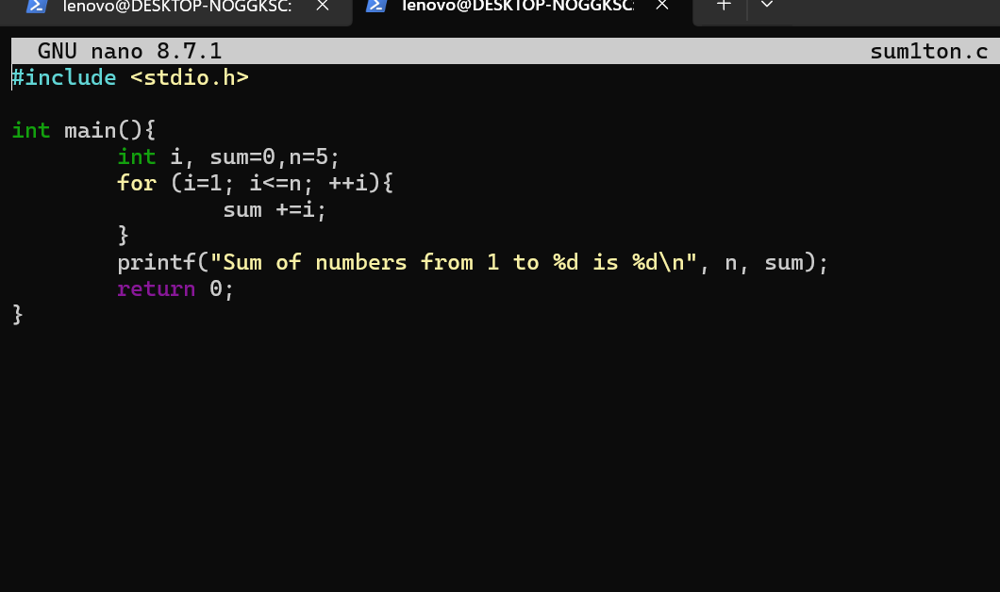
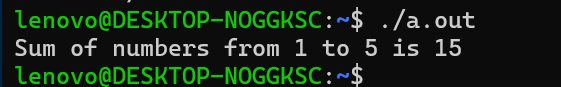
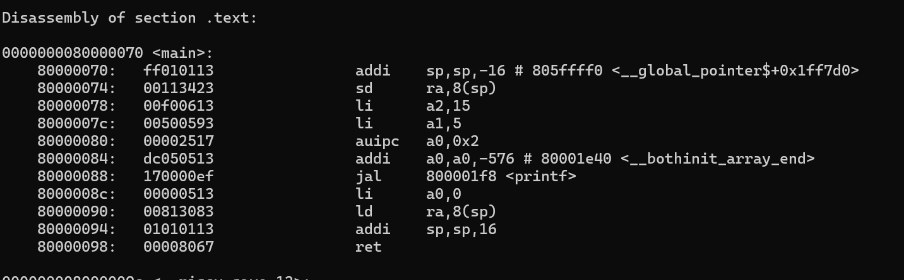
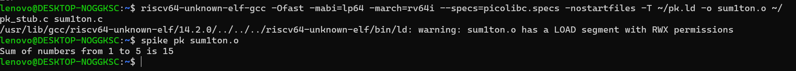
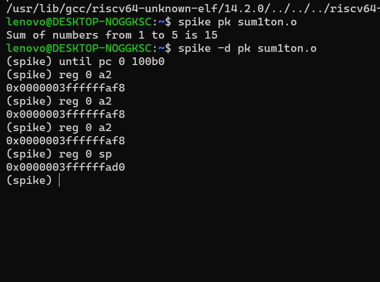
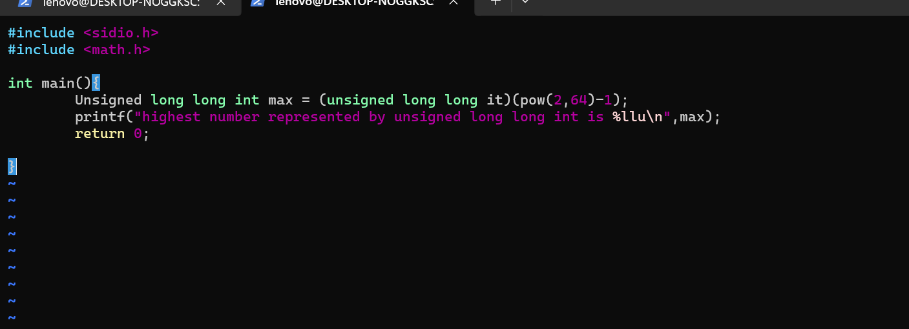
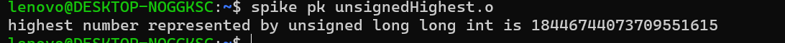
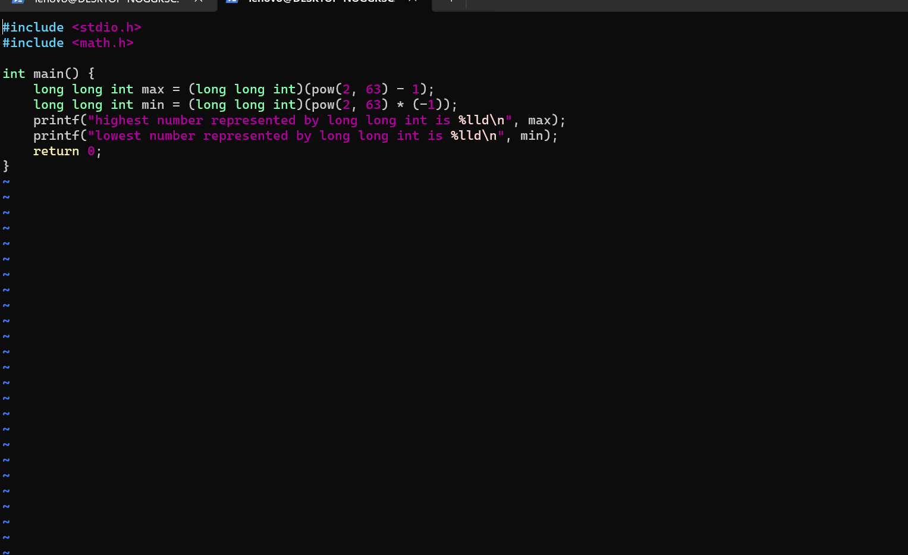
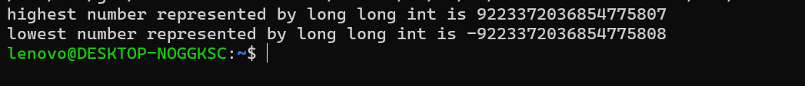

Day 1 — RISC-V Toolchain, Compilation, Simulation & Number Representation
This lab uses a simple C program to follow the path from source code to compiled execution, RISC-V disassembly, Spike simulation/debugging, and integer range experiments.

1. C Program: Sum from 1 to N
The first task is to calculate the sum of integers from 1 through `N`. Here, `N` is set to 5, so the expected result is `1 + 2 + 3 + 4 + 5 = 15`.
Source code (`sum1ton.c`)
```c
#include <stdio.h>

int main() {
    int i, sum = 0, n = 5;
    for (i = 1; i <= n; ++i) {
        sum += i;
    }
    printf("Sum of numbers from 1 to %d is %d\\n", n, sum);
    return 0;
}
```
`i` is the loop counter; `sum` accumulates the values; `n` is the limit (5).
The loop starts at 1, adds the current `i` to `sum`, and increments `i` until it passes `n`.

Compile and run the native program
```bash
gcc sum1ton.c -o a.out
./a.out
```
`gcc` compiles the source file into the executable `a.out`; `./a.out` runs it from the current directory.
Output:
```text
Sum of numbers from 1 to 5 is 15
```

---
2. Inspect the Compiled Program with Disassembly
Disassembly shows the machine instructions in a compiled program as assembly text. This gives a low-level view of how the program is represented for the target architecture.
Command
```bash
riscv64-unknown-elf-objdump -d sum1ton.o
```
The `-d` option disassembles executable sections. In the output, the address and encoded instruction are shown alongside assembly mnemonics. The screenshot shows the `main` routine, including instructions such as `addi`, `sd`, `li`, `auipc`, `jal`, `ld`, and `ret`.

---
3. Cross-Compile for RISC-V and Run with Spike
Instead of compiling for the host computer, the RISC-V cross-compiler builds the program for a RISC-V target. The shown build uses the RV64I architecture and LP64 ABI settings, along with the proxy-kernel startup/link setup.
RISC-V compilation command
```bash
riscv64-unknown-elf-gcc -Ofast -mabi=lp64 -march=rv64i \
  --specs=picolibc.specs -nostartfiles -T ~/pk.ld \
  -o sum1ton.o ~/pk_stub.c sum1ton.c
```
`-Ofast` enables aggressive optimization.
`-mabi=lp64` selects the LP64 ABI.
`-march=rv64i` targets the RV64I base instruction set.
`--specs=picolibc.specs` uses the picolibc specifications.
`-nostartfiles` omits the usual startup files.
`-T ~/pk.ld` uses the specified linker script.
`-o sum1ton.o` names the output file; the command also compiles `pk_stub.c` and `sum1ton.c`.
The terminal screenshot shows the linker warning about an RWX LOAD segment, followed by execution through Spike.

Run using Spike
```bash
spike pk sum1ton.o
```
`spike` launches the RISC-V ISA simulator; `pk` is the proxy kernel used to run the program. The simulated program prints the same sum, 15.

Enter Spike's debug mode
```bash
spike -d pk sum1ton.o
```
In the interactive debugger, the screenshots show register inspection commands:
```text
reg 0 a2
reg 0 sp
```
These inspect register values (including `a2` and `sp`) during the debug session. The displayed register values are snapshots from this run.
---
4. Unsigned `long long int` — Maximum Value
This exercise calculates the maximum value represented by an unsigned 64-bit `long long int` using `pow()`.
Source code (`unsignedHighest.c`)
```c
#include <stdio.h>
#include <math.h>

int main() {
    unsigned long long int max = (unsigned long long int)(pow(2, 64) - 1);
    printf("highest number represented by unsigned long long int is %llu\\n", max);
    return 0;
}
```
The expression uses `2^64 - 1` as the theoretical maximum for an unsigned 64-bit integer. `%llu` is the format specifier used to print an `unsigned long long` value.

Compile and simulate
```bash
riscv64-unknown-elf-gcc -Ofast -mabi=lp64 -march=rv64i \
  --specs=picolibc.specs -nostartfiles -T ~/pk.ld \
  -o unsignedHighest.o ~/pk_stub.c unsignedHighest.c
spike pk unsignedHighest.o
```
Observed output in this run:
```text
highest number represented by unsigned long long int is 18446744073709551615
```

---
5. Signed `long long int` — Maximum and Minimum Values
The next program attempts to calculate the maximum and minimum signed 64-bit values using `2^63 - 1` and `-2^63`.
Source code (`signedRange.c`)
```c
#include <stdio.h>
#include <math.h>

int main() {
    long long int max = (long long int)(pow(2, 63) - 1);
    long long int min = (long long int)(pow(2, 63) * (-1));
    printf("highest number represented by long long int is %lld\\n", max);
    printf("lowest number represented by long long int is %lld\\n", min);
    return 0;
}
```
For a signed 64-bit two's-complement integer, the theoretical range is `−2^63` through `2^63 − 1`. This code uses floating-point `pow()` and casts the result to an integer type; floating-point rounding at these large values can affect the result, so the output should be treated as the observed result of this method rather than a robust way to define integer limits.

Compile and simulate
```bash
riscv64-unknown-elf-gcc -Ofast -mabi=lp64 -march=rv64i \
  --specs=picolibc.specs -nostartfiles -T ~/pk.ld \
  -o signedRange.o ~/pk_stub.c signedRange.c
spike pk signedRange.o
```
Observed output in this run:
```text
highest number represented by long long int is 9223372036854775807
lowest number represented by long long int is -9223372036854775808
```

---
Day 1 Summary
Wrote and ran a basic C loop to sum integers from 1 to 5.
Viewed compiled code through RISC-V disassembly.
Cross-compiled the C program for RV64I and ran it in Spike.
Used Spike debug mode to inspect registers.
Explored unsigned and signed 64-bit integer ranges.