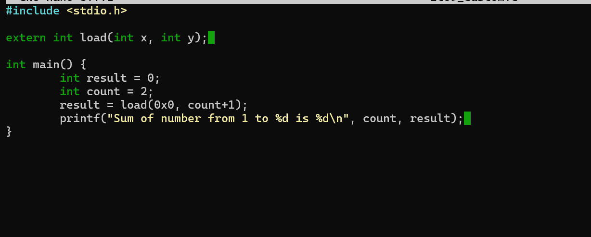
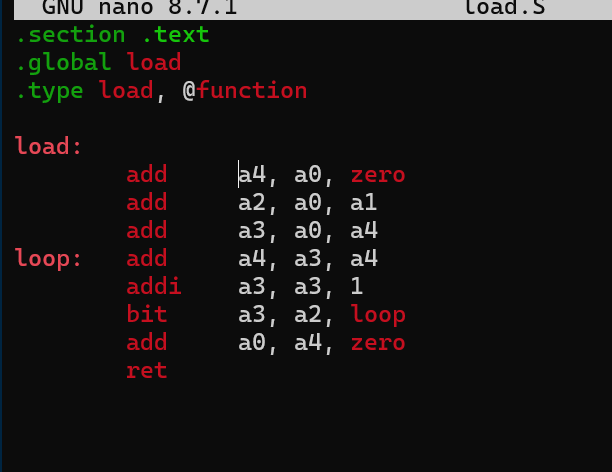
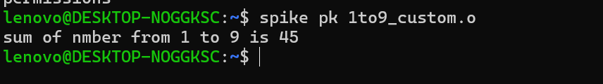
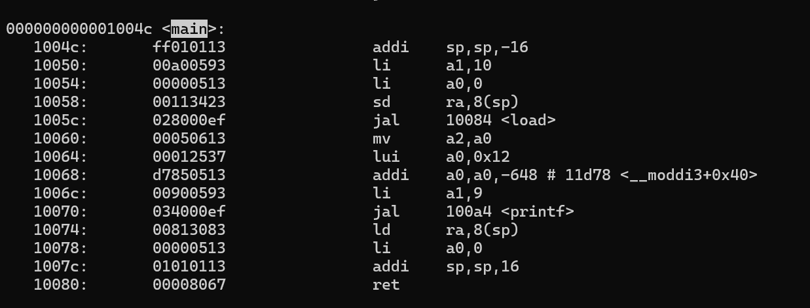
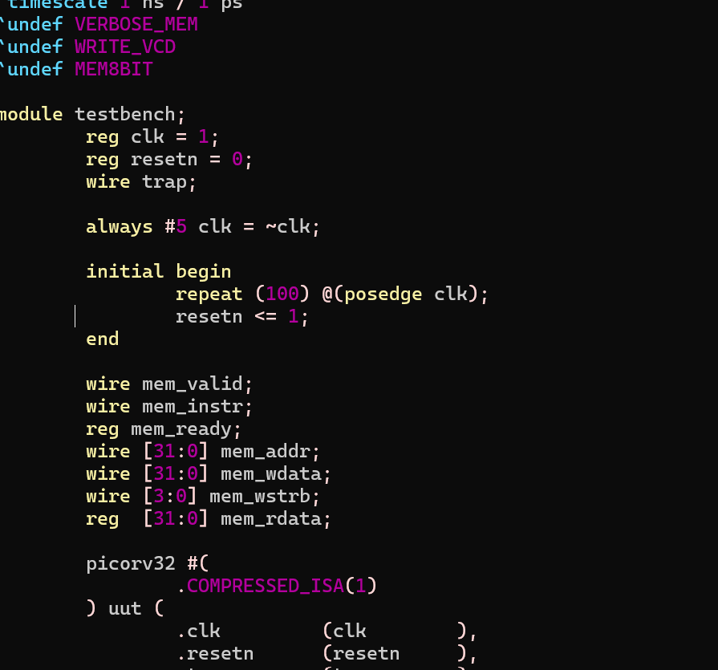

Day 2 — ABI Function Calls Using C and RISC-V Assembly

Day 2 explores the Application Binary Interface (ABI) by calling an assembly function from a C program. Instead of calculating the sum inside the C loop, the C program passes arguments to `load()` and the assembly function performs the summation.

1. C Program — Calling an Assembly Function
The C program declares `load()` as an external function. It passes the starting value and upper limit as arguments, receives the return value, and prints the sum.
```c
#include <stdio.h>

extern int load(int x, int y);

int main() {
    int result = 0;
    int count = 9;
    result = load(0x0, count + 1);
    printf("Sum of number from 1 to %d is %d\n", count, result);
    return 0;
}
```
Key points:
`extern int load(int x, int y);` tells the compiler that `load()` is defined in another source file.
`load(0x0, count + 1)` passes `0` as the starting value and `10` as the loop limit when `count` is 9.
The result returned by the assembly function is stored in `result` and printed.

2. Assembly Function — `load.S`
The `load` function is written in RISC-V assembly. It receives the arguments through the ABI argument registers and accumulates the sum in a loop.
```asm
.section .text
.global load
.type load, @function

load:
    add  a4, a0, zero
    add  a2, a0, a1
    add  a3, a0, a4
loop:
    add  a4, a3, a4
    addi a3, a3, 1
    blt  a3, a2, loop
    add  a0, a4, zero
    ret
```
Register roles in this routine:
`a0` — first argument initially; also the return-value register.
`a1` — second argument.
`a2` — loop's upper bound.
`a3` — loop counter.
`a4` — running sum.
`zero` — constant zero register.
Instruction flow: `add` initializes/updates registers, `addi` increments the loop counter, `blt` branches back while the counter is below the limit, and `ret` returns to the C caller. The final sum is moved into `a0` before returning.

3. Cross-Compile the C and Assembly Sources
Compile both source files together with the RISC-V cross-compiler:
```bash
riscv64-unknown-elf-gcc -Ofast -mabi=lp64 -march=rv64i -o 1to9_custom.o 1to9_custom.c load.S
```
Options:
`-Ofast` — enables aggressive compiler optimization.
`-mabi=lp64` — selects the LP64 ABI for the 64-bit RISC-V target.
`-march=rv64i` — targets the RV64I base integer instruction set.
`-o 1to9_custom.o` — names the generated output file.
`1to9_custom.c load.S` — compiles and links the C and assembly source files together.
4. Run on Spike Simulator
Execute the compiled program on Spike using the proxy kernel:

```bash
spike pk 1to9_custom.o
```
The C program calls the assembly `load()` function. The assembly loop computes the sum from 1 through 9, and the result is returned to C for printing.
Expected result for summing 1 through 9:
```text
sum of number from 1 to 9 is 45
```


What This Lab Demonstrates
A C program can call a function implemented in a separate assembly file.
The ABI defines how function arguments and return values are passed between C and assembly.
RISC-V ABI argument/return registers include `a0` and `a1`; the return value is placed in `a0`.
The compiler can compile and link C and assembly together into a RISC-V executable.
Spike provides a way to run and validate the compiled program on a RISC-V ISA simulator.

5. Disassembly of the Executable with `objdump`
After compiling, inspect the machine code and its corresponding RISC-V assembly instructions using `objdump`:

```bash

riscv64-unknown-elf-objdump -d 1to9_custom.o | less
**```

```
objdump displays information from the compiled object file.-d disassembles executable sections and shows assembly instructions.1to9_custom.o is the compiled object/executable being inspected.| less opens the output in a scrollable viewer so long disassembly listings can be examined page by page.
Use the arrow keys or Page Up/Page Down to scroll, and press q to exit less.
What to observe: the function labels, instruction addresses, and instructions generated for the program. Disassembly helps connect the C/assembly source to the machine-level instruction sequence


---


6. Inspecting picorv32.c with Vim
Open the processor source file in Vim:
```bash
vim picorv32.c
<<<<<<< HEAD
```

This command launches Vim and loads picorv32.c into the editor. It does not compile or execute the file. The purpose of this step is to inspect the processor source, navigate through its implementation, and identify the code relevant to the lecture/lab.

In Vim:

Use arrow keys or h, j, k, l to navigate.

Press Esc to return to normal mode.

Type :q and press Enter to quit if no changes were made.

If changes were made and you want to save, use :wq to write and quit.

Result: the file's source code is displayed in Vim for inspection. The screenshot documents the code opened in the editor; it is not program output.


7. Inspecting testbench.c with Vim
Open the testbench source:
```bash
vim testbench.c
```

This loads testbench.c into Vim for reading or editing. A testbench is used as a verification environment: it typically provides inputs or test scenarios to a design and observes the behavior to check whether the expected results occur. The exact details should be interpreted from the code visible in this screenshot.

Result: Vim displays the testbench source code so its structure and test logic can be reviewed. Opening the file alone does not start a simulation or produce pass/fail output.

Identify how the test is set up.

Look for input/stimulus generation and checks or expected values, if present in the code.

Exit with :q if unchanged, or save and exit with :wq if you edited it.


---
8. Day 2 Summary
This work demonstrates the C-to-assembly function call and ABI argument/return handling, running the program in Spike, inspecting the compiled instructions with `objdump`, and opening processor/testbench source files for code review. The `objdump` and Vim steps are inspection activities: they help you understand the generated instructions and source files, while the Spike command is the step that runs the compiled program and shows its result.
