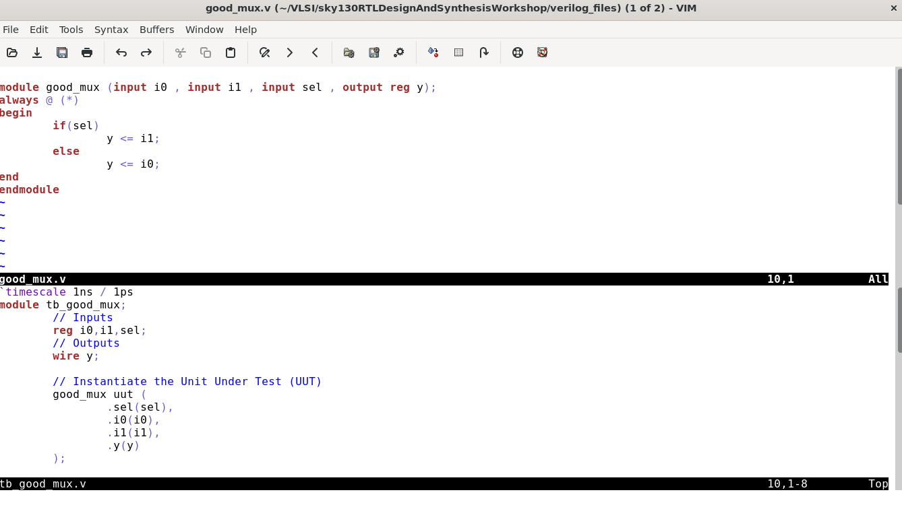
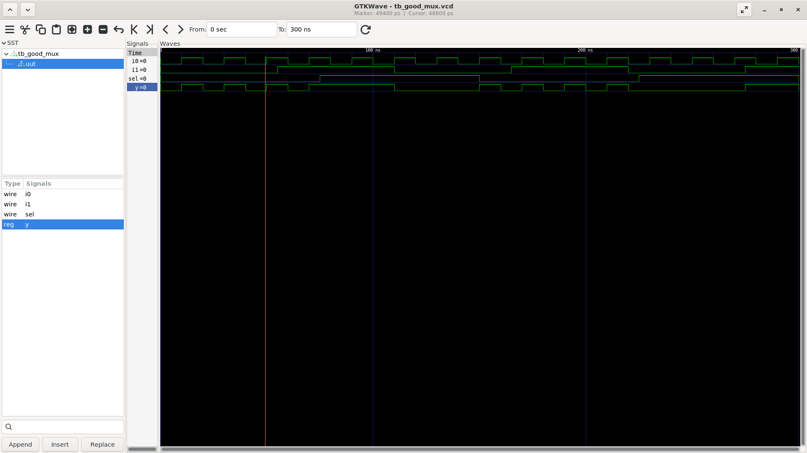
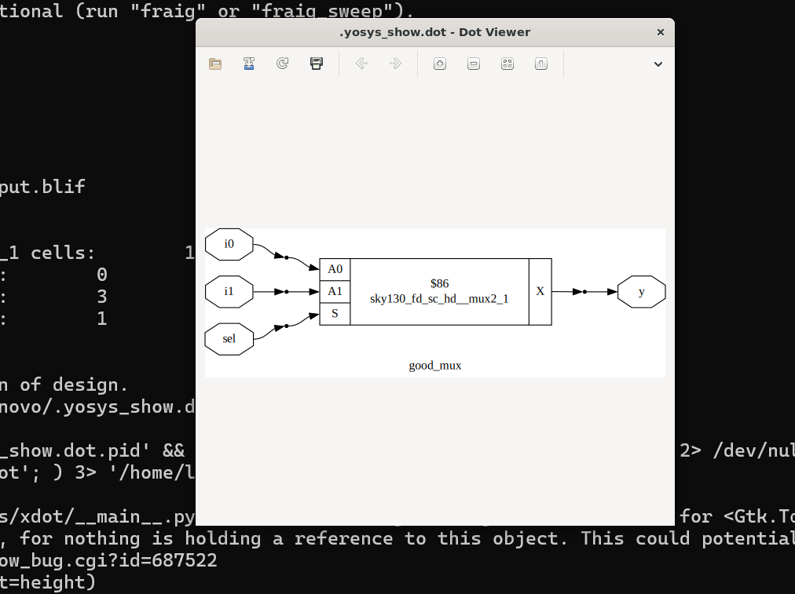

# Day 1 — Introduction to Verilog RTL Design & Logic Synthesis

[← Back to RTL index](../README.md)

## Objective

Set up the open-source RTL-to-gates toolchain and run it end to end on a 2:1 multiplexer: write the RTL and testbench, simulate with Icarus Verilog, check the waveform in GTKWave, then synthesize to SkyWater 130 nm standard cells with Yosys + ABC.

## Tools Used

- **Icarus Verilog (`iverilog` / `vvp`)** — compiles the RTL + testbench and runs the simulation
- **GTKWave** — displays the Value Change Dump (`.vcd`) produced by the testbench
- **Yosys & ABC** — translates behavioural Verilog into a gate-level netlist mapped to `sky130_fd_sc_hd` cells

---

## 1. Key Concepts

### RTL Design-to-Synthesis Flow

```text
Verilog RTL (.v) + Testbench (tb_*.v)
                ↓
   Icarus Verilog simulation (iverilog → ./a.out)
                ↓
   Waveform verification in GTKWave (.vcd)
                ↓
   Yosys RTL synthesis + ABC technology mapping (.lib)
                ↓
   Gate-level netlist & schematic (sky130_fd_sc_hd)
```

### Design vs. Testbench

- The **Design Under Test** (`good_mux.v`) contains the synthesizable hardware description, here an `always @(*)` block.
- The **testbench** (`tb_good_mux.v`) has **no ports**. It instantiates the design as `uut`, drives stimulus on `reg` signals, observes outputs on `wire`s, and dumps waveforms with `$dumpfile` / `$dumpvars`.
- A **simulator** only evaluates the design when an input changes; it produces the `.vcd` file that GTKWave displays.

---

## 2. Lab — Simulating `good_mux` with Icarus Verilog & GTKWave

### Step 1: Inspect the RTL and testbench

```bash
cd ~/VLSI/sky130RTLDesignAndSynthesisWorkshop/verilog_files
gvim -o good_mux.v tb_good_mux.v
```

```verilog
module good_mux (input i0 , input i1 , input sel , output reg y);
always @ (*)
begin
    if(sel)
        y <= i1;
    else
        y <= i0;
end
endmodule
```



**Observation:**
- **Top split (`good_mux.v`):** a 2:1 multiplexer written with `always @(*)`, so `y` is re-evaluated whenever `i0`, `i1`, or `sel` changes (`y = sel ? i1 : i0`).
- **Bottom split (`tb_good_mux.v`):** declares `reg i0, i1, sel` for stimulus and `wire y` for the output, and instantiates `good_mux uut (.sel(sel), .i0(i0), .i1(i1), .y(y))`. The timescale is `1ns / 1ps`.

### Step 2: Run the RTL simulation and view the waveform

```bash
iverilog good_mux.v tb_good_mux.v
./a.out
gtkwave tb_good_mux.vcd
```



**Observation:**
- While **`sel = 0`** (0–75 ns and 150–225 ns), `y` is an exact copy of `i0`.
- While **`sel = 1`** (75–150 ns and 225–300 ns), `y` follows `i1`.
- `y` changes immediately with the selected input and never holds an old value, which confirms purely combinational MUX behaviour.

---

## 3. Lab — Synthesizing `good_mux` with Yosys

### Standard-cell library basics

- A **`.lib` (Liberty) file** is the collection of standard cells (AND, OR, MUX, flip-flops…) with their function, area, power, and timing.
- The file name encodes the **PVT corner**: `sky130_fd_sc_hd__tt_025C_1v80.lib` = typical process (`tt`), 25 °C, 1.80 V.
- The library offers several **flavours of each cell** (e.g. `_1`, `_2`, `_4` drive strengths). Faster/wider cells meet setup timing more easily but cost area and power; slower cells help with hold timing. The synthesizer is guided by constraints to pick the right one.

### Yosys commands

```bash
cd ~/VLSI/sky130RTLDesignAndSynthesisWorkshop/verilog_files
yosys
```

Inside the `yosys>` prompt:

```tcl
read_liberty -lib ../my_lib/lib/sky130_fd_sc_hd__tt_025C_1v80.lib
read_verilog good_mux.v
synth -top good_mux
abc -liberty ../my_lib/lib/sky130_fd_sc_hd__tt_025C_1v80.lib
show
```

| Command | Purpose |
|---|---|
| `read_liberty -lib` | Loads the Sky130 standard cells (typical corner, 25 °C, 1.80 V) as black-box library cells |
| `read_verilog` | Parses the RTL source |
| `synth -top good_mux` | Elaborates the design and performs generic logic optimisation |
| `abc -liberty` | Maps the generic logic onto real Sky130 standard cells |
| `show` | Draws the resulting gate-level schematic in the Dot Viewer (`xdot`) |



**Observation:**
- Yosys + ABC map the entire `if (sel)` description onto **one** standard cell: **`sky130_fd_sc_hd__mux2_1`**.
- Inputs `i0`, `i1`, and `sel` connect directly to the cell pins `A0`, `A1`, and `S`; output pin `X` drives the primary output `y`.
- The ABC statistics in the terminal behind the viewer report a single cell for the design.

---

## 4. Key Learning Outcomes

- Writing clean combinational Verilog (`always @(*)`) and a port-less testbench
- Running a simulation with `iverilog` / `./a.out` and verifying signals in GTKWave
- Understanding what a `.lib` file contains and how the PVT corner is encoded in its name
- Synthesizing behavioural RTL with Yosys + ABC into a Sky130 gate-level schematic (`sky130_fd_sc_hd__mux2_1`)

[Next: Day 2 →](../Day_2/README.md)
