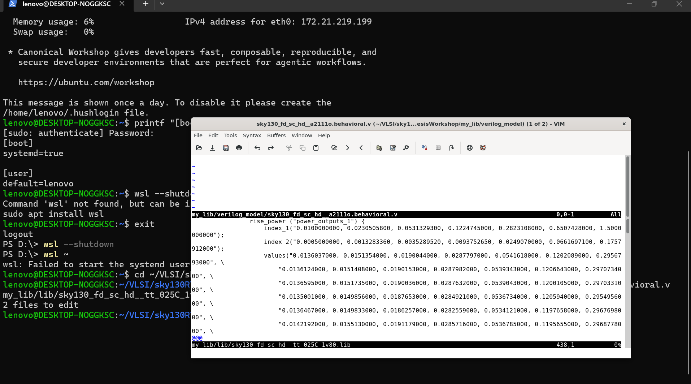
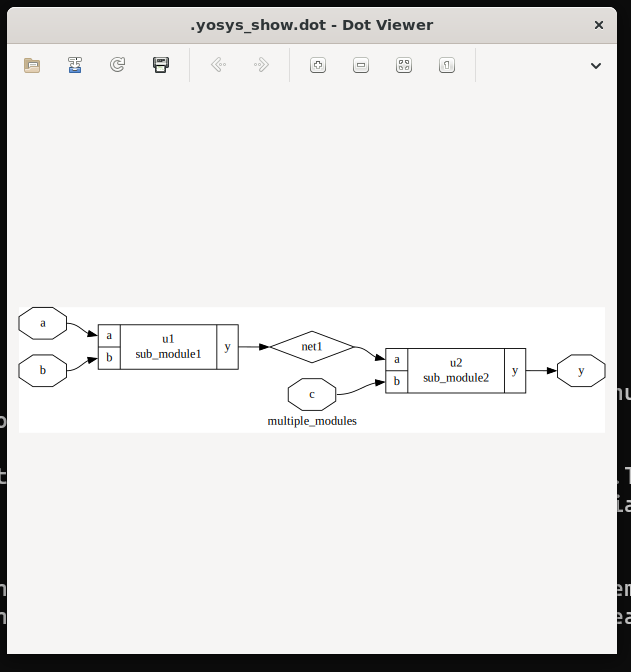
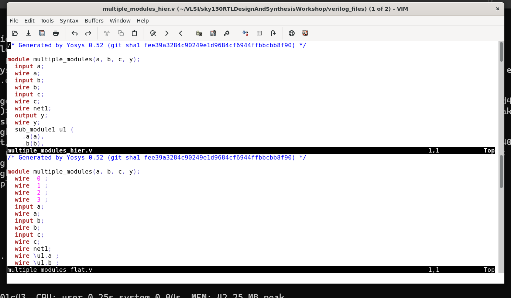
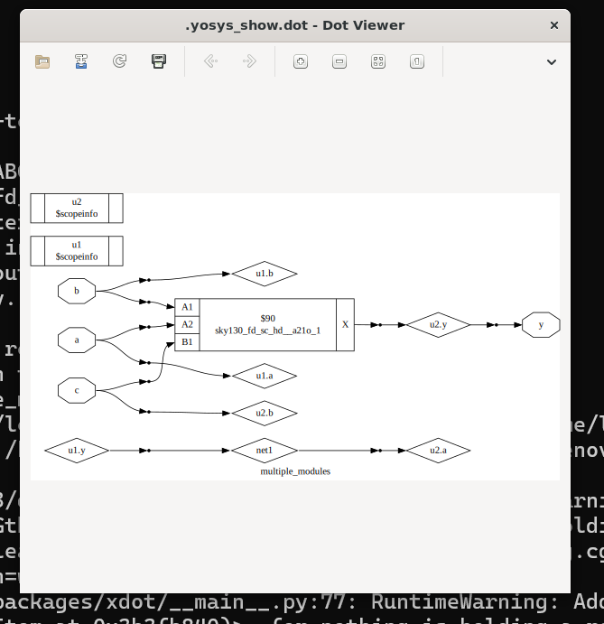
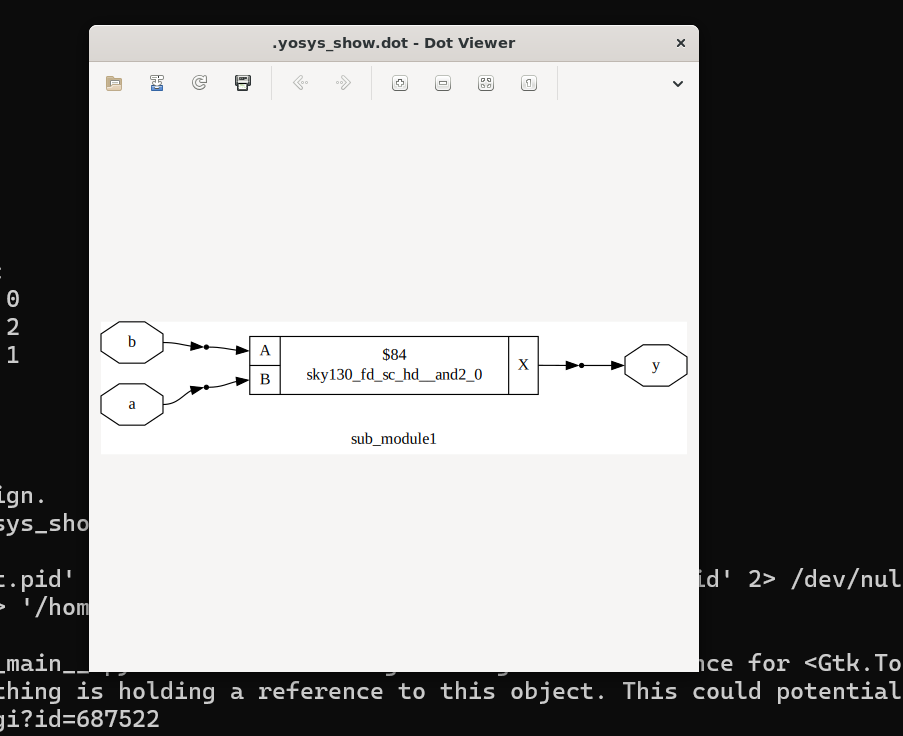
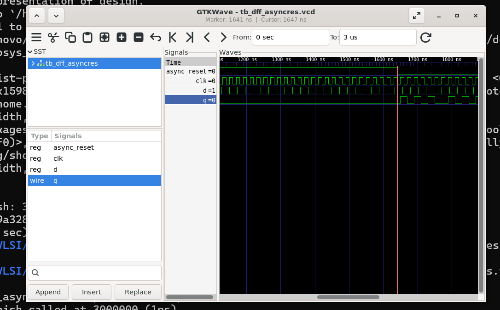
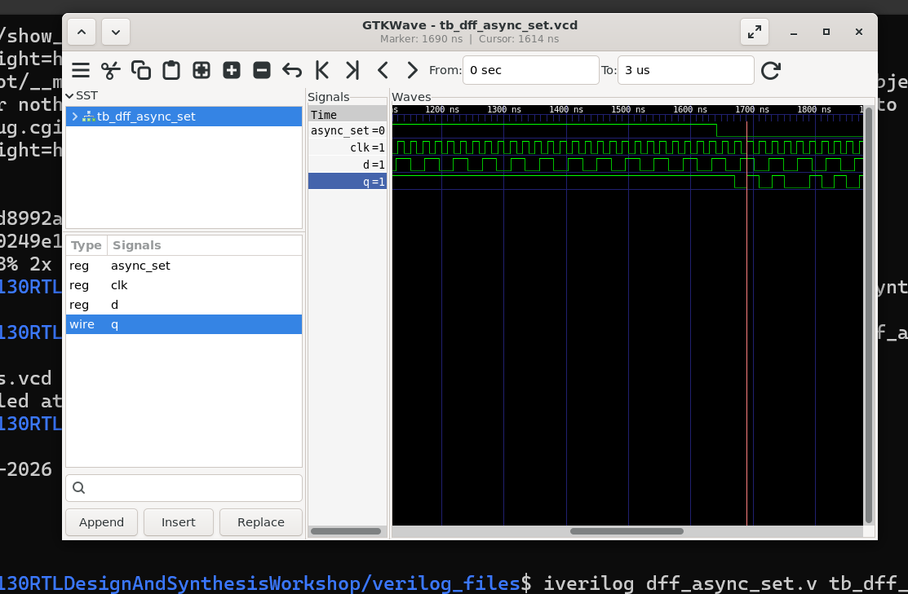
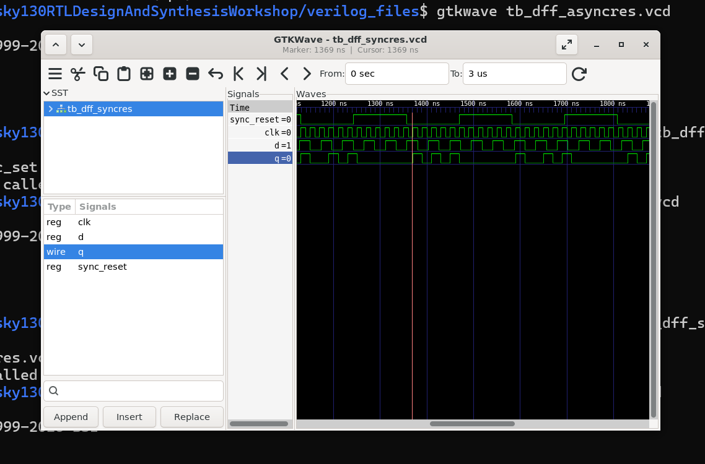
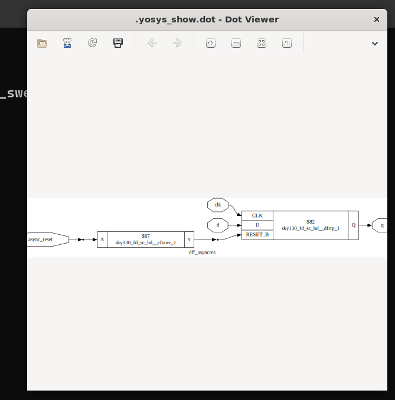

# Day 2 — Timing Libraries, Hierarchical vs. Flat Synthesis & Flip-Flop Coding Styles

[← Back to RTL index](../README.md)

## Objective

- Read a Sky130 Liberty (`.lib`) file and understand how cell timing/power is characterised.
- Compare a **hierarchical** netlist with a **flattened** one, and synthesize a single sub-module on its own.
- Simulate and synthesize flip-flops with **asynchronous reset**, **asynchronous set**, and **synchronous reset**.

---

## 1. Timing Libraries (`.lib`)

```bash
cd ~/VLSI/sky130RTLDesignAndSynthesisWorkshop
gvim -o my_lib/verilog_model/sky130_fd_sc_hd__a2111o.behavioral.v my_lib/lib/sky130_fd_sc_hd__tt_025C_1v80.lib
```



**Observation:**
- The upper pane (the `a2111o` behavioural model) opened as an empty buffer; the Liberty file in the lower pane is what this step inspects.
- **File name = PVT corner.** `tt_025C_1v80` means typical process, 25 °C, 1.80 V. The same cells are also characterised at other corners (e.g. `ff` / `ss`, other temperatures and voltages), because silicon speed changes with process, voltage, and temperature.
- The visible lower pane shows a **`rise_power("power_outputs_1")` table**: a 2-D lookup table where
  - `index_1` = input transition time,
  - `index_2` = output load capacitance,
  - `values` = the characterised value for every (transition, load) pair.
- The tool interpolates between table points. Timing (`cell_rise`, `cell_fall`, …) is stored the same way, which is what the **NLDM** (Non-Linear Delay Model) refers to.
- Every cell in the `.lib` also records its pins, Boolean `function`, area, and leakage power. Different drive strengths of the same function (e.g. `and2_0`, `and2_1`, `and2_2`, `and2_4`) trade area/power for speed.

---

## 2. Hierarchical vs. Flat Synthesis

### RTL — `multiple_modules.v`

```verilog
module sub_module2 (input a, input b, output y);
    assign y = a | b;
endmodule

module sub_module1 (input a, input b, output y);
    assign y = a&b;
endmodule

module multiple_modules (input a, input b, input c , output y);
    wire net1;
    sub_module1 u1(.a(a),.b(b),.y(net1));  //net1 = a&b
    sub_module2 u2(.a(net1),.b(c),.y(y));  //y = net1|c ,ie y = a&b + c;
endmodule
```

### Yosys commands

```tcl
read_liberty -lib ../my_lib/lib/sky130_fd_sc_hd__tt_025C_1v80.lib
read_verilog multiple_modules.v
synth -top multiple_modules
abc -liberty ../my_lib/lib/sky130_fd_sc_hd__tt_025C_1v80.lib
show multiple_modules
write_verilog -noattr multiple_modules_hier.v

flatten
write_verilog -noattr multiple_modules_flat.v
show
```

### 2.1 Hierarchical synthesis



**Observation:** the hierarchy is **preserved**. The top module contains two instances, `u1` (`sub_module1`) and `u2` (`sub_module2`), connected through `net1`. The gates inside each sub-module are not visible at this level.

### 2.2 Hierarchical vs. flattened netlist



**Observation:**
- **`multiple_modules_hier.v` (top):** the netlist still instantiates `sub_module1 u1 ( .a(a), .b(b), … )`, so the sub-modules remain separate modules in the file.
- **`multiple_modules_flat.v` (bottom):** there are no sub-module instances. All logic sits directly in `multiple_modules`, and the old hierarchy survives only as wire names such as `\u1.a` and `\u1.b` plus Yosys-generated wires `_0_` … `_3_`.

### 2.3 Flattened design



**Observation:**
- After `flatten`, Yosys optimises across the old module boundary and the whole design collapses into **one cell, `sky130_fd_sc_hd__a21o_1`**: inputs `A1 = b`, `A2 = a`, `B1 = c`, so **`y = (a & b) | c`**, exactly the intended function.
- The `$scopeinfo` boxes for `u1` and `u2` are bookkeeping cells that record where the original hierarchy was; they are not real logic.

---

## 3. Sub-Module Level Synthesis

```tcl
read_liberty -lib ../my_lib/lib/sky130_fd_sc_hd__tt_025C_1v80.lib
read_verilog multiple_modules.v
synth -top sub_module1
abc -liberty ../my_lib/lib/sky130_fd_sc_hd__tt_025C_1v80.lib
show
```



**Observation:** with `-top sub_module1`, only that module is synthesized. It maps to a single **`sky130_fd_sc_hd__and2_0`** gate (`y = a & b`).

**Why synthesize a sub-module alone?**
- If the same module is instantiated many times, synthesize it **once** and reuse the netlist.
- For very large designs, splitting the work by module (**divide and conquer**) keeps each synthesis run manageable.

---

## 4. Flip-Flop Coding Styles

### RTL

```verilog
// Asynchronous reset — q is cleared immediately when async_reset goes high
module dff_asyncres ( input clk ,  input async_reset , input d , output reg q );
always @ (posedge clk , posedge async_reset)
begin
    if(async_reset)
        q <= 1'b0;
    else
        q <= d;
end
endmodule
```

```verilog
// Asynchronous set — q is forced to 1 immediately when async_set goes high
module dff_async_set ( input clk ,  input async_set , input d , output reg q );
always @ (posedge clk , posedge async_set)
begin
    if(async_set)
        q <= 1'b1;
    else
        q <= d;
end
endmodule
```

```verilog
// Synchronous reset — reset is only sampled on the clock edge
module dff_syncres ( input clk , input async_reset , input sync_reset , input d , output reg q );
always @ (posedge clk )
begin
    if (sync_reset)
        q <= 1'b0;
    else
        q <= d;
end
endmodule
```

### Simulation commands

```bash
iverilog dff_asyncres.v tb_dff_asyncres.v && ./a.out && gtkwave tb_dff_asyncres.vcd
iverilog dff_async_set.v tb_dff_async_set.v && ./a.out && gtkwave tb_dff_async_set.vcd
iverilog dff_syncres.v  tb_dff_syncres.v  && ./a.out && gtkwave tb_dff_syncres.vcd
```

### 4.1 Asynchronous reset



**Observation:** while `async_reset` is high (up to ≈ 1640 ns), `q` is held at **0** regardless of `clk` and `d`. Once reset is released, `q` starts following `d` on each rising clock edge.

### 4.2 Asynchronous set



**Observation:** while `async_set` is high (up to ≈ 1640 ns), `q` is held at **1**. After `async_set` falls, `q` follows `d` on the following rising clock edges.

### 4.3 Synchronous reset



**Observation:** `sync_reset` pulses high several times (≈ 1240–1355 ns, ≈ 1470–1585 ns, ≈ 1695–1810 ns). `q` is cleared to 0 only **at the next rising clock edge** after `sync_reset` goes high, not at the instant reset rises, and it stays 0 for as long as reset is high. Between pulses, `q` samples `d` normally.

### 4.4 Synthesis of `dff_asyncres`

Flip-flops need one extra step, **`dfflibmap`**, which maps Yosys's generic flip-flops onto the flip-flop cells in the `.lib` before ABC maps the remaining logic:

```tcl
read_liberty -lib ../my_lib/lib/sky130_fd_sc_hd__tt_025C_1v80.lib
read_verilog dff_asyncres.v
synth -top dff_asyncres
dfflibmap -liberty ../my_lib/lib/sky130_fd_sc_hd__tt_025C_1v80.lib
abc -liberty ../my_lib/lib/sky130_fd_sc_hd__tt_025C_1v80.lib
show
```



**Observation:**
- The flop maps to **`sky130_fd_sc_hd__dfrtp_1`** (D flip-flop with asynchronous reset).
- Its reset pin is **`RESET_B`**, which is **active-low**, while the RTL reset `async_reset` is active-high. Yosys therefore inserts a **`sky130_fd_sc_hd__clkinv_1`** inverter between `async_reset` and `RESET_B`.
- `clk → CLK`, `d → D`, `Q → q`.

> Synthesis schematics for `dff_async_set` / `dff_syncres` and the `mult_2` / `mult_8` optimisation labs were not captured as screenshots.

---

## Key Learnings

- A `.lib` file holds each cell's function, area, power, and timing, characterised as 2-D lookup tables at a specific PVT corner.
- Hierarchical synthesis keeps module boundaries; `flatten` removes them so Yosys can optimise across boundaries (here, down to a single `a21o_1`).
- `synth -top <sub_module>` synthesizes one module at a time for reuse and divide-and-conquer.
- Asynchronous set/reset acts immediately; synchronous reset only takes effect on a clock edge.
- Flip-flops need `dfflibmap`; polarity mismatches between RTL and the library cell (active-high reset vs. `RESET_B`) are fixed with an inserted inverter.

[← Day 1](../Day_1/README.md) · [Day 3 →](../Day_3/README.md)
