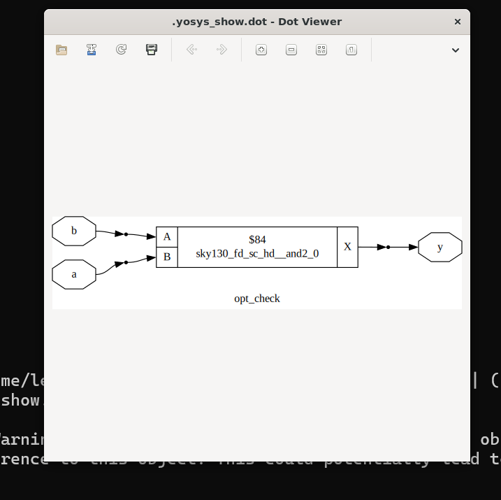
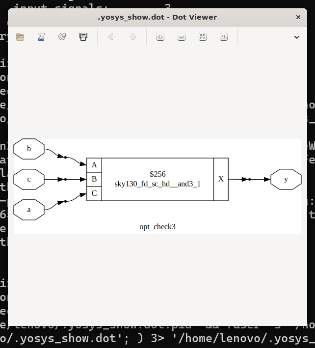
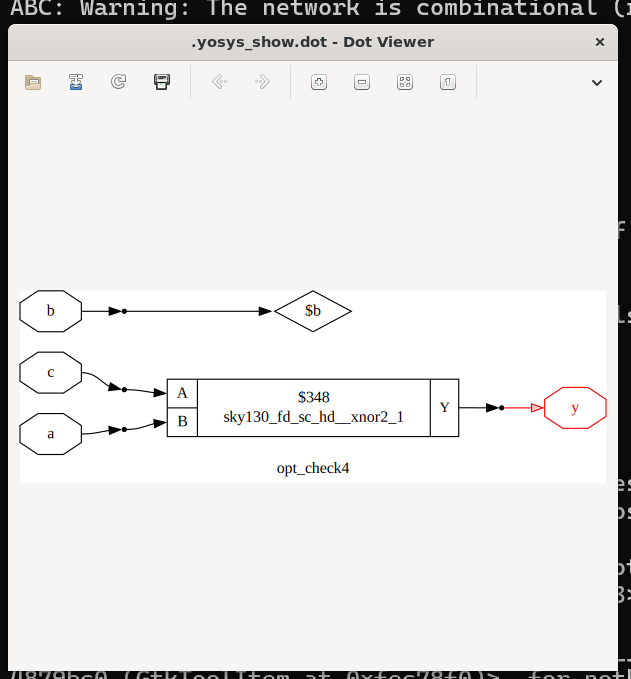
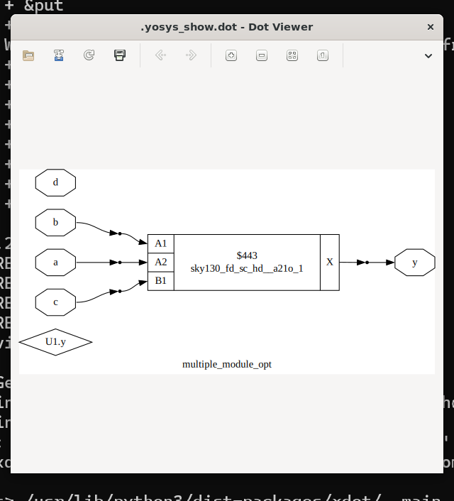
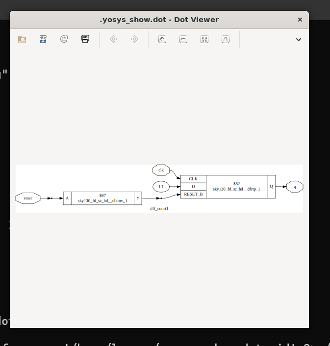
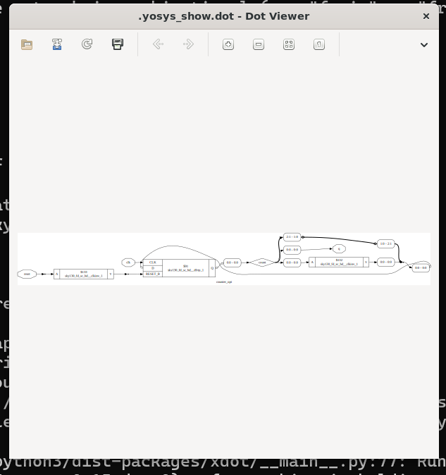

# Day 3 — Combinational & Sequential Logic Optimisations

[← Back to RTL index](../README.md)

## Objective

See how Yosys simplifies logic during synthesis:
- **Combinational:** constant propagation and Boolean simplification, including across module boundaries once the design is flattened.
- **Sequential:** flops whose value is fixed or whose output is never used are simplified or removed.

---

## 1. Combinational Logic Optimisation

### Yosys flow

`opt_clean -purge` removes unused wires and cells after `synth`, so the final schematic shows only the logic that is actually needed:

```tcl
read_liberty -lib ../my_lib/lib/sky130_fd_sc_hd__tt_025C_1v80.lib
read_verilog opt_check.v
synth -top opt_check
opt_clean -purge
abc -liberty ../my_lib/lib/sky130_fd_sc_hd__tt_025C_1v80.lib
show
```

The same commands are repeated for each design, changing the file and `-top` name.

### 1.1 `opt_check` — MUX with a constant 0 input

```verilog
module opt_check (input a , input b , output y);
    assign y = a?b:0;
endmodule
```



**Observation:** `y = a ? b : 0` is just `a & b`. Instead of a MUX, Yosys produces a single **`sky130_fd_sc_hd__and2_0`**.

### 1.2 `opt_check3` — nested MUX with constant 0 inputs

```verilog
module opt_check3 (input a , input b, input c , output y);
    assign y = a?(c?b:0):0;
endmodule
```



**Observation:** both MUXes have a 0 input, so the expression reduces to `y = a & b & c`, implemented as one **`sky130_fd_sc_hd__and3_1`**.

### 1.3 `opt_check4` — Boolean simplification

```verilog
module opt_check4 (input a , input b , input c , output y);
    assign y = a?(b?(a & c ):c):(!c);
endmodule
```



**Observation:**
- When `a = 1`: `b ? (1 & c) : c` = `c`.
- When `a = 0`: `!c`.
- So `y = a ? c : !c` = **`a XNOR c`**. Input `b` has no effect at all.
- The schematic is a single **`sky130_fd_sc_hd__xnor2_1`** driven by `a` and `c`; `b` is left unconnected (dangling `$b`).

### 1.4 `multiple_module_opt` — optimisation across module boundaries

```verilog
module sub_module1(input a , input b , output y);
    assign y = a & b;
endmodule

module sub_module2(input a , input b , output y);
    assign y = a^b;
endmodule

module multiple_module_opt(input a , input b , input c , input d , output y);
wire n1,n2,n3;

sub_module1 U1 (.a(a) , .b(1'b1) , .y(n1));
sub_module2 U2 (.a(n1), .b(1'b0) , .y(n2));
sub_module2 U3 (.a(b), .b(d) , .y(n3));

assign y = c | (b & n1);
endmodule
```

Constants can only propagate across module boundaries once the hierarchy is removed, so `flatten` is added before cleaning:

```tcl
read_liberty -lib ../my_lib/lib/sky130_fd_sc_hd__tt_025C_1v80.lib
read_verilog multiple_module_opt.v
synth -top multiple_module_opt
flatten
opt_clean -purge
abc -liberty ../my_lib/lib/sky130_fd_sc_hd__tt_025C_1v80.lib
show
```



**Observation:**
- `U1` computes `a & 1'b1` = `a`, so `n1 = a` and `y = c | (b & a)`.
- `n2` (from `U2`) and `n3` (from `U3`) are never used, so both instances are removed, and input **`d` ends up unconnected**.
- The whole design becomes **one `sky130_fd_sc_hd__a21o_1`** (`X = (A1 & A2) | B1` with `A1 = b`, `A2 = a`, `B1 = c`). `U1.y` remains only as a net name.

---

## 2. Sequential Logic Optimisation

For designs with flops, `dfflibmap` is added before `abc`:

```tcl
read_liberty -lib ../my_lib/lib/sky130_fd_sc_hd__tt_025C_1v80.lib
read_verilog dff_const1.v
synth -top dff_const1
dfflibmap -liberty ../my_lib/lib/sky130_fd_sc_hd__tt_025C_1v80.lib
abc -liberty ../my_lib/lib/sky130_fd_sc_hd__tt_025C_1v80.lib
show
```

### 2.1 `dff_const1` — constant D input, but the flop is still needed

```verilog
module dff_const1(input clk, input reset, output reg q);
always @(posedge clk, posedge reset)
begin
    if(reset)
        q <= 1'b0;
    else
        q <= 1'b1;
end
endmodule
```



**Observation:**
- Although `D` is always `1'b1`, **`q` is not a constant**: it is 0 while `reset` is high and only becomes 1 at the first rising clock edge after reset is released.
- Yosys therefore **keeps the flop**: a **`sky130_fd_sc_hd__dfrtp_1`** with `D` tied to `1'1`, plus a **`sky130_fd_sc_hd__clkinv_1`** to convert the active-high `reset` into the cell's active-low `RESET_B`.

### 2.2 `counter_opt` — unused counter bits are removed

```verilog
module counter_opt (input clk , input reset , output q);
reg [2:0] count;
assign q = count[0];

always @(posedge clk ,posedge reset)
begin
    if(reset)
        count <= 3'b000;
    else
        count <= count + 1;
end
endmodule
```



**Observation:**
- The RTL describes a **3-bit** counter, but only `count[0]` drives the output.
- `count[1]` and `count[2]` affect nothing visible, so their flops and the adder logic are **removed**.
- What remains is **one `sky130_fd_sc_hd__dfrtp_1`** whose output is fed back through a **`clkinv_1`** into its own `D` input (bit 0 of a counter simply toggles every clock), plus a second **`clkinv_1`** for the active-low reset.

> The other Day 3 variants (`opt_check2`, `multiple_module_opt2`, `dff_const2`–`dff_const5`, `counter_opt2`) were not captured as screenshots.

---

## Key Learnings

- Constant inputs on MUXes collapse them into simple gates (`and2`, `and3`), and Boolean simplification can remove inputs entirely (`opt_check4` ignores `b`).
- `flatten` + `opt_clean -purge` lets Yosys propagate constants across module boundaries and delete unused instances.
- A flop with a constant `D` is **not** automatically removable: if reset makes its output differ from `D`, it must stay.
- Flops whose outputs never reach a primary output are removed, so a 3-bit counter observed only through bit 0 becomes a single toggle flop.

[← Day 2](../Day_2/README.md) · [Day 4 →](../Day_4/README.md)
