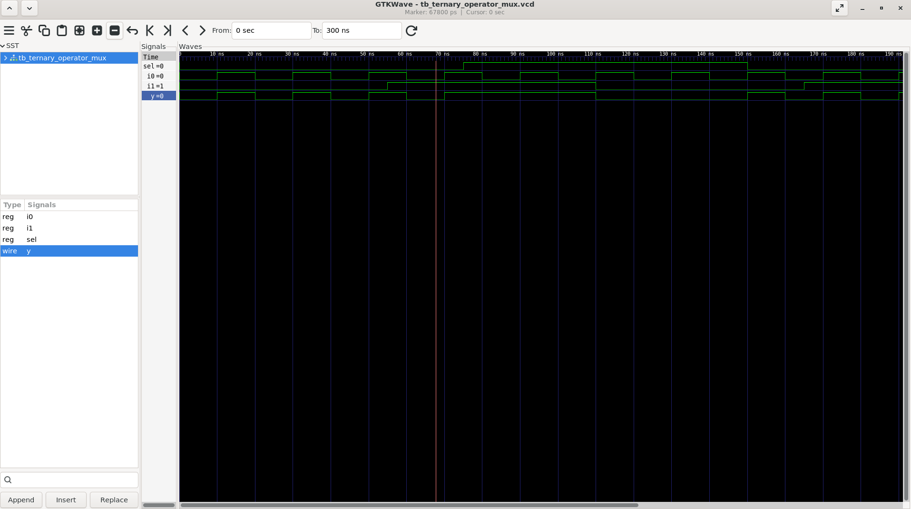
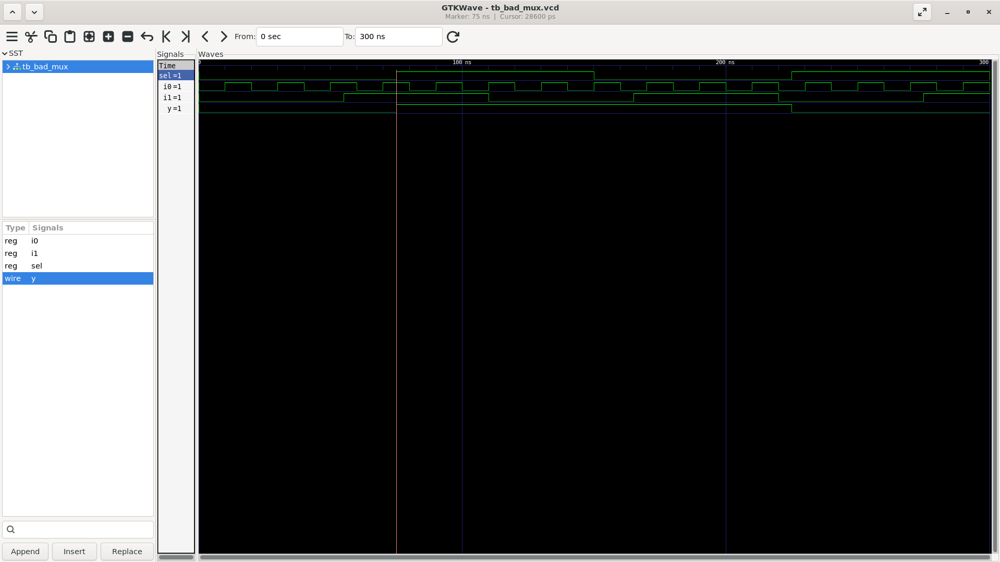
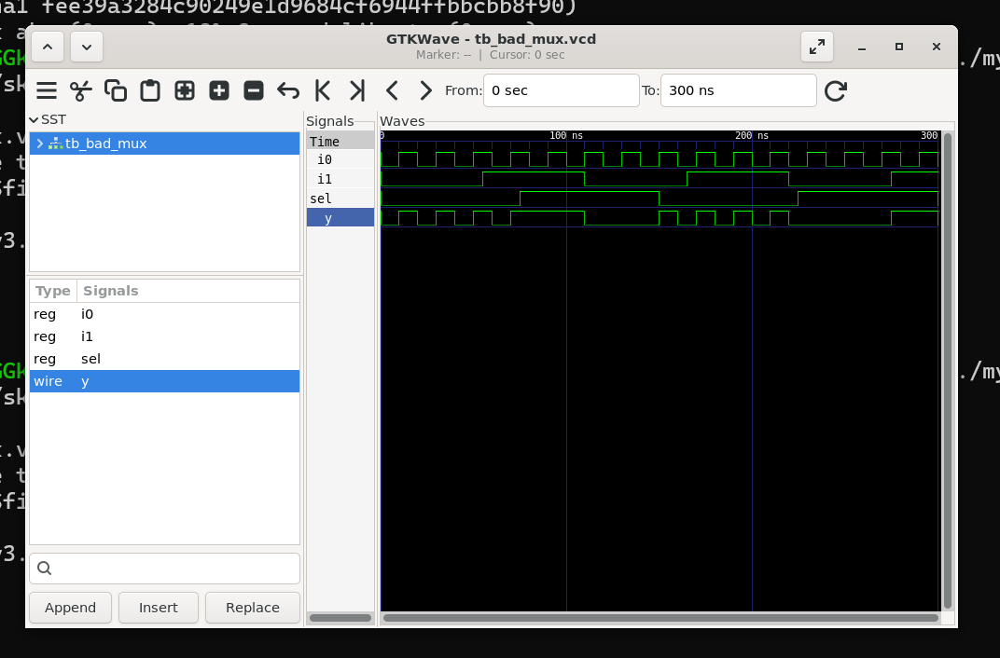
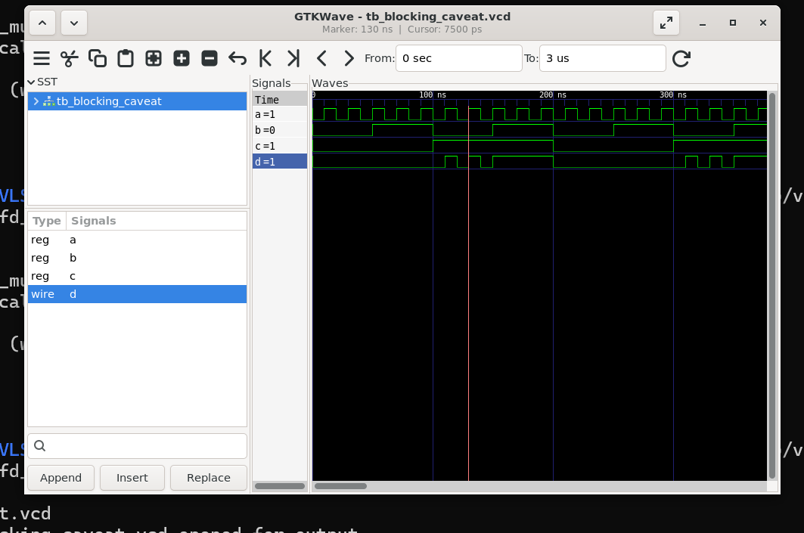

# Day 4 — Gate-Level Simulation (GLS), Synthesis–Simulation Mismatch & Blocking vs. Non-Blocking

[← Back to RTL index](../README.md)

## Objective

- Run **Gate-Level Simulation**: simulate the synthesized netlist with the original testbench.
- Reproduce two classic **synthesis–simulation mismatches**: an incomplete sensitivity list and blocking-assignment ordering.

---

## 1. Introduction to Gate-Level Simulation

### Why GLS?

- RTL simulation checks the **description**; GLS checks the **netlist that will actually be built**.
- Running the same testbench on the netlist confirms that synthesis preserved the intended logic.
- Some RTL coding styles simulate one way but synthesize another. GLS exposes these mismatches.

### GLS flow

```text
RTL (.v) ──► Yosys synthesis ──► netlist (*_net.v)
                                      │
   primitives.v + sky130_fd_sc_hd.v ──┤   (Verilog models of the standard cells)
                                      │
                testbench (tb_*.v) ───┴──► iverilog ──► ./a.out ──► .vcd ──► GTKWave
```

The netlist instantiates cells like `sky130_fd_sc_hd__mux2_1`, so iverilog needs the cell models from `../my_lib/verilog_model/` to simulate it.

---

## 2. Functional GLS — `ternary_operator_mux`

### RTL

```verilog
module ternary_operator_mux (input i0 , input i1 , input sel , output y);
    assign y = sel?i1:i0;
endmodule
```

### RTL simulation

```bash
iverilog ternary_operator_mux.v tb_ternary_operator_mux.v
./a.out
gtkwave tb_ternary_operator_mux.vcd
```

### Synthesis and netlist generation

```tcl
read_liberty -lib ../my_lib/lib/sky130_fd_sc_hd__tt_025C_1v80.lib
read_verilog ternary_operator_mux.v
synth -top ternary_operator_mux
abc -liberty ../my_lib/lib/sky130_fd_sc_hd__tt_025C_1v80.lib
write_verilog -noattr ternary_operator_mux_net.v
```

### Gate-level simulation

```bash
iverilog ../my_lib/verilog_model/primitives.v ../my_lib/verilog_model/sky130_fd_sc_hd.v ternary_operator_mux_net.v tb_ternary_operator_mux.v
./a.out
gtkwave tb_ternary_operator_mux.vcd
```



**Observation:**
- `sel = 0` (0–75 ns): `y` copies `i0`.
- `sel = 1` (75–150 ns): `y` copies `i1`. It stays high until `i1` falls at ≈ 110 ns, then stays low.
- `sel = 0` again from 150 ns: `y` follows `i0` once more.
- The output is exactly `sel ? i1 : i0`, the expected 2:1 MUX behaviour. A continuous `assign` has no sensitivity list, so RTL and gate-level simulation are expected to agree for this design.

---

## 3. Mismatch #1 — Incomplete Sensitivity List (`bad_mux`)

### RTL

```verilog
module bad_mux (input i0 , input i1 , input sel , output reg y);
always @ (sel)
begin
    if(sel)
        y <= i1;
    else
        y <= i0;
end
endmodule
```

The `always` block is only sensitive to **`sel`**. A simulator therefore re-evaluates `y` **only when `sel` changes**, even though `y` also depends on `i0` and `i1`. A synthesizer ignores the sensitivity list and builds a normal MUX.

### RTL simulation

```bash
iverilog bad_mux.v tb_bad_mux.v
./a.out
gtkwave tb_bad_mux.vcd
```



**Observation (RTL):**
- `y` changes **only at the `sel` edges** (75 ns, 150 ns, 225 ns). In between, it ignores `i0` and `i1` completely.
- Example: from ≈ 110 ns to 150 ns, `sel = 1` and `i1 = 0`, yet `y` is still **1**.
- From 150 ns to 225 ns (`sel = 0`), `i0` keeps toggling but `y` stays flat.
- This is latch-like behaviour that does **not** match a MUX.

### Synthesis + GLS

```tcl
read_liberty -lib ../my_lib/lib/sky130_fd_sc_hd__tt_025C_1v80.lib
read_verilog bad_mux.v
synth -top bad_mux
abc -liberty ../my_lib/lib/sky130_fd_sc_hd__tt_025C_1v80.lib
write_verilog -noattr bad_mux_net.v
```

```bash
iverilog ../my_lib/verilog_model/primitives.v ../my_lib/verilog_model/sky130_fd_sc_hd.v bad_mux_net.v tb_bad_mux.v
./a.out
gtkwave tb_bad_mux.vcd
```



**Observation (GLS):**
- The netlist is a real 2:1 MUX, so `y` now **follows `i0` whenever `sel = 0` and `i1` whenever `sel = 1`**, including all the toggles the RTL simulation missed.
- **RTL and GLS disagree** for the same testbench. That is the synthesis–simulation mismatch.

**Fix:** use `always @(*)` so the simulator is sensitive to every signal read inside the block:

```verilog
always @(*)
begin
    if(sel)
        y <= i1;
    else
        y <= i0;
end
```

---

## 4. Mismatch #2 — Blocking Assignment Ordering (`blocking_caveat`)

### Blocking vs. non-blocking

| | Blocking `=` | Non-blocking `<=` |
|---|---|---|
| Execution | Statements run **in order**; each assignment completes before the next line | All right-hand sides are evaluated first, then all left-hand sides update **together** |
| Typical use | Combinational logic | Sequential logic (flip-flops) |
| Risk | Statement order changes the result | Safe for sequential logic regardless of order |

### RTL

```verilog
module blocking_caveat (input a , input b , input  c, output reg d);
reg x;
always @ (*)
begin
    d = x & c;
    x = a | b;
end
endmodule
```

The intended logic is **`d = (a | b) & c`**. Because `d = x & c` executes **before** `x = a | b`, the RTL simulator computes `d` from the **previous** value of `x`. The simulation behaves as if `x` were stored in a flop. Synthesis ignores this ordering subtlety and builds a plain OR-AND, so RTL and GLS can disagree.

### Synthesis + GLS

```tcl
read_liberty -lib ../my_lib/lib/sky130_fd_sc_hd__tt_025C_1v80.lib
read_verilog blocking_caveat.v
synth -top blocking_caveat
abc -liberty ../my_lib/lib/sky130_fd_sc_hd__tt_025C_1v80.lib
write_verilog -noattr blocking_caveat_net.v
```

```bash
iverilog ../my_lib/verilog_model/primitives.v ../my_lib/verilog_model/sky130_fd_sc_hd.v blocking_caveat_net.v tb_blocking_caveat.v
./a.out
gtkwave tb_blocking_caveat.vcd
```



**Observation (GLS):**
- The netlist output matches **`d = (a | b) & c` at every edge**:
  - 100–150 ns: `c = 1`, `b = 0`, so `d` follows `a` exactly (high at 110–120 ns and 130–140 ns, with no lag).
  - 150–200 ns: `b = 1`, `c = 1`, so `d = 1`.
  - 200–300 ns: `c = 0`, so `d = 0`.
- This is the hardware's behaviour. In an RTL simulation of the same file, `d` would instead lag one evaluation behind, because it reads the stale `x`.

**Fix:** order blocking assignments so every value is computed before it is used:

```verilog
always @(*)
begin
    x = a | b;
    d = x & c;
end
```

For **sequential** logic, use non-blocking assignments so that statement order does not matter:

```verilog
always @(posedge clk)
begin
    q  <= q0;
    q0 <= d;
end
```

> Only the GLS side of `blocking_caveat` was captured; an RTL-simulation screenshot showing the lagging `d` would complete the comparison.

---

## Key Learnings

- GLS runs the original testbench on the synthesized netlist using the Sky130 cell models (`primitives.v`, `sky130_fd_sc_hd.v`).
- An incomplete sensitivity list makes RTL simulation hold old values that the synthesized MUX never holds. Use `always @(*)`.
- With blocking assignments, statement order matters: reading a variable before it is assigned simulates like a flop, but synthesizes as wires.
- Use blocking `=` for combinational logic (in dependency order) and non-blocking `<=` for sequential logic.

[← Day 3](../Day_3/README.md) · [Day 5 →](../Day_5/README.md)
