# Day 5 — Synthesis Optimisations: `if` / `case` Constructs & `for` / `for-generate` Loops

[← Back to RTL index](../README.md)

## Objective

- Understand what hardware `if-else` and `case` statements infer, and how **incomplete** statements cause **unintended latches**.
- See how an overlapping `case` item causes a simulation mismatch.
- Use procedural `for` loops and `for-generate` blocks to describe repetitive hardware (MUX, DEMUX, ripple-carry adder).

### Common commands

```bash
# RTL simulation
iverilog <design>.v tb_<design>.v
./a.out
gtkwave tb_<design>.vcd
```

```tcl
# Synthesis (inside yosys)
read_liberty -lib ../my_lib/lib/sky130_fd_sc_hd__tt_025C_1v80.lib
read_verilog <design>.v
synth -top <design>
abc -liberty ../my_lib/lib/sky130_fd_sc_hd__tt_025C_1v80.lib
show
```

> **Note on latch cells:** in every schematic below, the inferred latches appear as Yosys's generic **`$_DLATCH_P_`** (enable active-high) or **`$_DLATCH_N_`** (enable active-low) cells. They were not mapped to a Sky130 latch cell (such as `sky130_fd_sc_hd__dlxtp_1`) in these runs.

---

## 1. `if-else` and Latch Inference

- An `if / else if / else` chain builds a **priority MUX chain**: the first true condition wins.
- If some path through the `always @(*)` block **does not assign** the output, the output must keep its old value. Holding a value requires storage, so synthesis infers a **latch**. In combinational logic this is almost always a bug.

### 1.1 `incomp_if` — `if` without `else`

```verilog
module incomp_if (input i0 , input i1 , input i2 , output reg y);
always @ (*)
begin
    if(i0)
        y <= i1;
end
endmodule
```

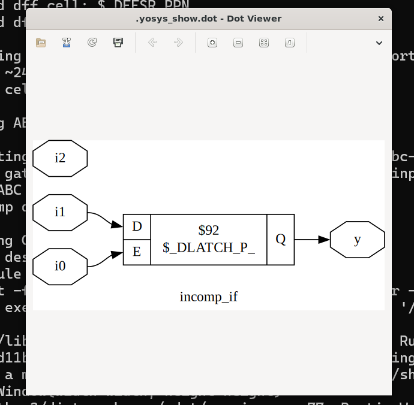

**Observation:**
- There is no `else`, so when `i0 = 0` the value of `y` is undefined by the code and must be **held**.
- Yosys infers a **`$_DLATCH_P_`**: `D = i1`, enable `E = i0`. The latch is transparent (`y = i1`) while `i0 = 1` and holds while `i0 = 0`.
- Input `i2` is declared but unused, so it stays unconnected.

### 1.2 `incomp_if2` — `if / else if` without a final `else`

```verilog
module incomp_if2 (input i0 , input i1 , input i2 , input i3, output reg y);
always @ (*)
begin
    if(i0)
        y <= i1;
    else if (i2)
        y <= i3;
end
endmodule
```

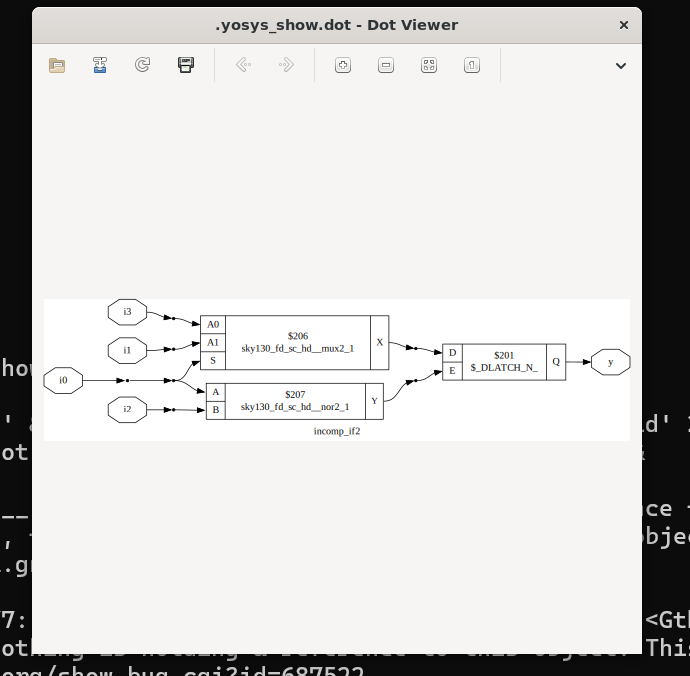

**Observation:**
- **`sky130_fd_sc_hd__mux2_1`** (`S = i0`, `A1 = i1`, `A0 = i3`) picks the data: `i1` if `i0`, otherwise `i3`.
- **`sky130_fd_sc_hd__nor2_1`** (`i0`, `i2`) drives the enable of a **`$_DLATCH_N_`** (active-low enable). The latch is transparent whenever **`i0 | i2`** is true and holds when both are 0, which is the missing `else` case.

---

## 2. `case` Statements and Latch Inference

- A `case` statement builds a MUX selected by the case expression.
- If some values of the select are **not covered** and there is no `default`, the output is not assigned for those values, so a **latch** is inferred.
- A `default` branch (or covering every value) removes the latch.

### 2.1 `incomp_case` — missing `default`

```verilog
module incomp_case (input i0 , input i1 , input i2 , input [1:0] sel, output reg y);
always @ (*)
begin
    case(sel)
        2'b00 : y = i0;
        2'b01 : y = i1;
    endcase
end
endmodule
```

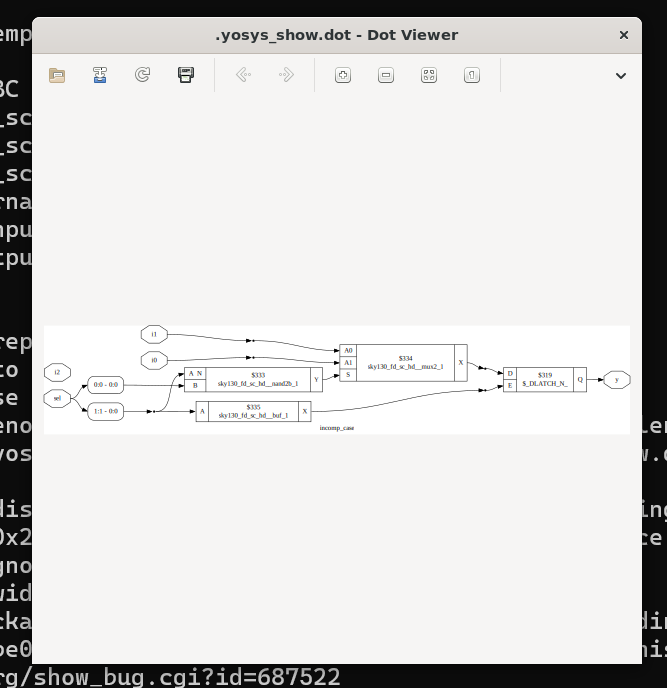

**Observation:**
- `sel = 10` and `sel = 11` are not covered, so `y` must hold for those values.
- **`sky130_fd_sc_hd__mux2_1`** chooses between `i0` and `i1` (its select comes from a **`nand2b_1`** on `sel[1:0]`).
- A **`$_DLATCH_N_`** stores the result. Its enable comes through a **`buf_1`** from **`sel[1]`**, so the latch is transparent for `sel = 00 / 01` and **holds** for `sel = 10 / 11`.
- `i2` is never used.

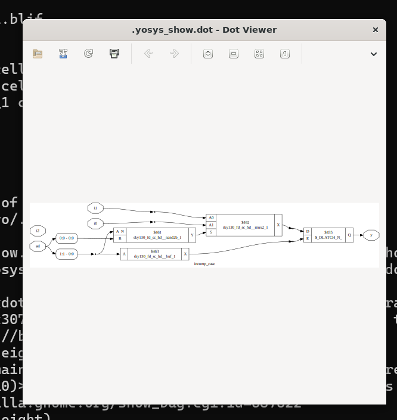

**Observation:** a second synthesis run of `incomp_case` produces the identical structure (`nand2b_1` + `mux2_1` + `buf_1` + `$_DLATCH_N_`); only Yosys's internal cell IDs differ. The latch inference is reproducible and comes from the RTL, not from the tool run.

### 2.2 `comp_case` — `default` added

```verilog
module comp_case (input i0 , input i1 , input i2 , input [1:0] sel, output reg y);
always @ (*)
begin
    case(sel)
        2'b00 : y = i0;
        2'b01 : y = i1;
        default : y = i2;
    endcase
end
endmodule
```

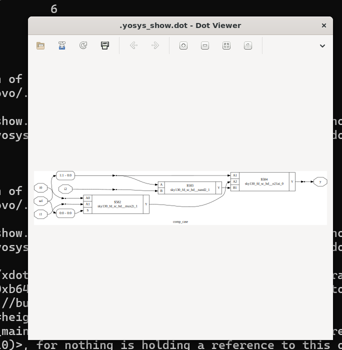

**Observation:** with a `default`, every value of `sel` assigns `y`, so the design is purely combinational: **`mux2i_1` + `nand2_1` + `o21ai_0`**, with **no latch**.

### 2.3 `partial_case_assign` — output not assigned in every branch

```verilog
module partial_case_assign (input i0 , input i1 , input i2 , input [1:0] sel, output reg y , output reg x);
always @ (*)
begin
    case(sel)
        2'b00 : begin
            y = i0;
            x = i2;
            end
        2'b01 : y = i1;
        default : begin
            x = i1;
            y = i2;
            end
    endcase
end
endmodule
```

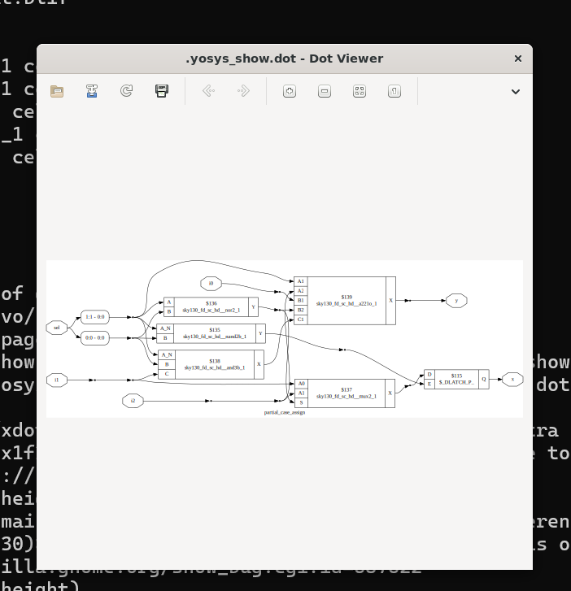

**Observation:**
- **`y`** is assigned in every branch, so it is built from plain gates (`nor2_1`, `nand2b_1`, `and3b_1`, `a221o_1`) with **no latch**.
- **`x`** is **not assigned when `sel = 01`**, so a **`$_DLATCH_P_`** is inferred on `x`, fed by a `mux2_1`.
- Having a `default` is not enough: **every output must be assigned in every branch** (or given a default value before the `case`).

### 2.4 `bad_case` — overlapping / wildcard `case` item

```verilog
module bad_case (input i0 , input i1, input i2, input i3 , input [1:0] sel, output reg y);
always @(*)
begin
    case(sel)
        2'b00: y = i0;
        2'b01: y = i1;
        2'b10: y = i2;
        2'b1?: y = i3;
        //2'b11: y = i3;
    endcase
end
endmodule
```

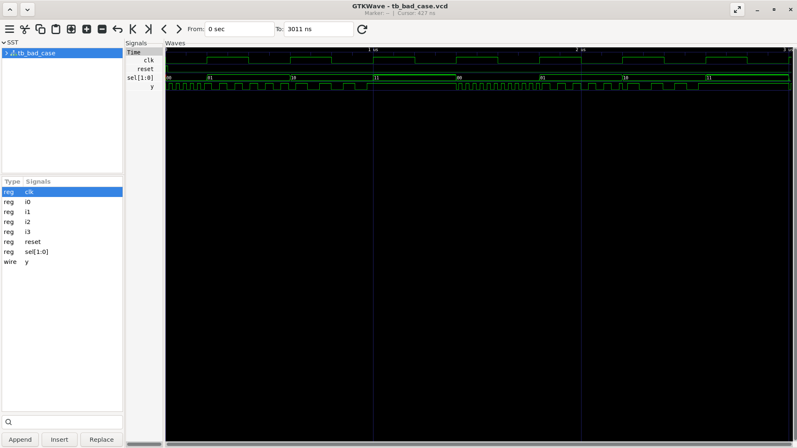

**Observation (RTL simulation):**
- For `sel = 00 / 01 / 10`, `y` follows `i0 / i1 / i2` as expected.
- During both **`sel = 11`** windows (≈ 1.0–1.4 µs and ≈ 2.6–3.0 µs), **`y` freezes** at its last value.
- In a plain `case`, `?` means `z` and is compared literally, so `2'b11` does **not** match `2'b1?`. No branch executes and the simulator holds `y`.
- Synthesis treats `?` as a don't-care, so the netlist drives `y = i3` for `sel = 11`. **RTL and gate-level results differ.**

**Fix:** avoid overlapping items. List `2'b11` explicitly, or use `casez` for intentional wildcards, and always add a `default`.

> The GLS side of `bad_case` was not captured.

---

## 3. Procedural `for` Loops (inside `always`)

A `for` loop inside an `always` block **evaluates** repeated expressions. It does not create copies of hardware, which makes it handy for wide MUX/DEMUX logic.

### 3.1 `mux_generate` — 4:1 MUX with a `for` loop

```verilog
module mux_generate (input i0 , input i1, input i2 , input i3 , input [1:0] sel  , output reg y);
wire [3:0] i_int;
assign i_int = {i3,i2,i1,i0};
integer k;
always @ (*)
begin
for(k = 0; k < 4; k=k+1) begin
    if(k == sel)
        y = i_int[k];
end
end
endmodule
```

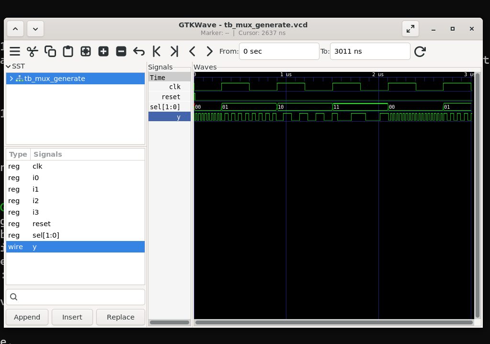

**Observation:** as `sel` steps through `00 → 01 → 10 → 11`, `y` follows `i0`, `i1`, `i2`, `i3` in turn. The four inputs toggle at different rates in the testbench, which is why `y` changes speed with each `sel` value.

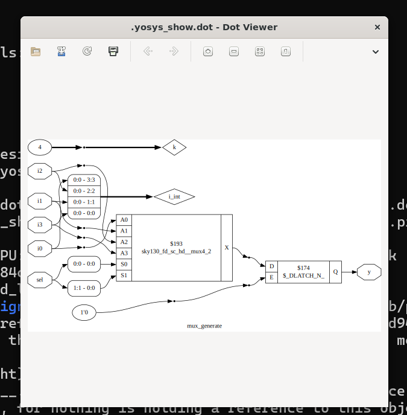

**Observation:**
- The loop maps to a single **`sky130_fd_sc_hd__mux4_2`** (`A0–A3 = i0–i3`, `S0/S1 = sel[0]/sel[1]`).
- Its output passes through a **`$_DLATCH_N_`** whose **enable is tied to the constant `1'0`**. An active-low enable stuck at 0 means the latch is **always transparent**, so functionally it is just a wire.
- It appears because `y` has **no default assignment before the loop**: Yosys first infers storage for the "no iteration matched" case, then proves the enable is constant, but the latch cell stays in the netlist.
- Adding `y = 1'b0;` before the `for` loop should give a clean `mux4` with no latch.

### 3.2 `demux_generate` — 1:8 DEMUX with a `for` loop

```verilog
module demux_generate (output o0 , output o1, output o2 , output o3, output o4, output o5, output o6 , output o7 , input [2:0] sel  , input i);
reg [7:0]y_int;
assign {o7,o6,o5,o4,o3,o2,o1,o0} = y_int;
integer k;
always @ (*)
begin
y_int = 8'b0;
for(k = 0; k < 8; k++) begin
    if(k == sel)
        y_int[k] = i;
end
end
endmodule
```

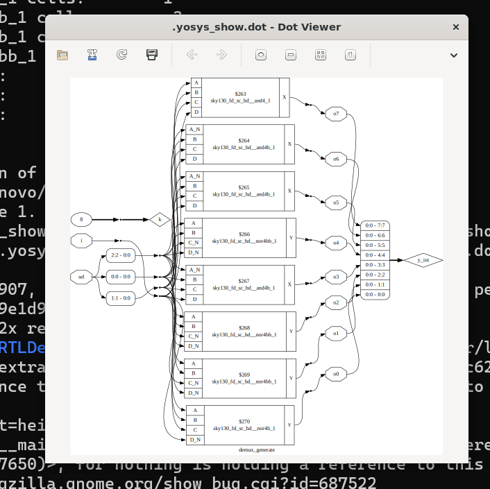

**Observation:**
- Here `y_int = 8'b0` is assigned **before** the loop, so every output always has a value and **no latch** is inferred.
- Each output `o0`–`o7` becomes **one 4-input gate** that ANDs `i` with the decoded `sel[2:0]`:
  - `and4_1` → `o7`
  - `and4b_1` → `o6`, `o5`, `o3`
  - `nor4bb_1` → `o4`, `o2`, `o1`
  - `nor4b_1` → `o0`
- The `_b` / `_bb` variants have built-in inverted inputs, so no separate inverters are needed for the `sel` bits that must be 0.

---

## 4. `for-generate` — Replicating Hardware

`generate` + `genvar` loops sit **outside** `always` blocks and **instantiate hardware multiple times**, e.g. an n-bit adder built from n full adders.

### 4.1 Ripple-Carry Adder (`rca.v` + `fa.v`)

```verilog
module fa (input a , input b , input c, output co , output sum);
    assign {co,sum}  = a + b + c ;
endmodule
```

```verilog
module rca (input [7:0] num1 , input [7:0] num2 , output [8:0] sum);
wire [7:0] int_sum;
wire [7:0]int_co;

genvar i;
generate
    for (i = 1 ; i < 8; i=i+1) begin
        fa u_fa_1 (.a(num1[i]),.b(num2[i]),.c(int_co[i-1]),.co(int_co[i]),.sum(int_sum[i]));
    end
endgenerate

fa u_fa_0 (.a(num1[0]),.b(num2[0]),.c(1'b0),.co(int_co[0]),.sum(int_sum[0]));

assign sum[7:0] = int_sum;
assign sum[8] = int_co[7];
endmodule
```

Bit-width rule: adding two **n-bit** numbers needs **n + 1** bits, so the 8-bit adder has a **9-bit** sum.

```bash
iverilog fa.v rca.v tb_rca.v
./a.out
gtkwave tb_rca.vcd
```

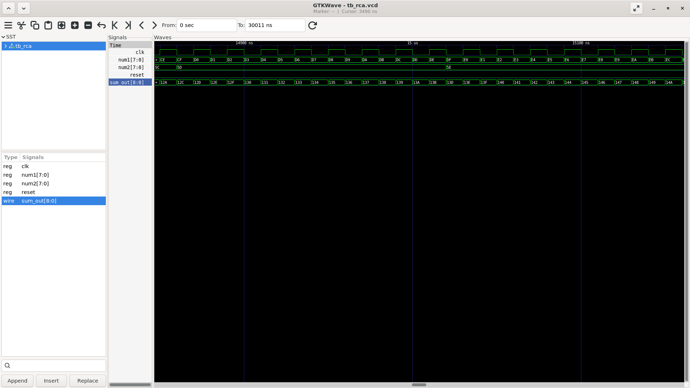

**Observation:** the 9-bit `sum_out` is the correct sum of `num1` and `num2` at every step. For example:

| `num1` | `num2` | `sum_out` | Check (decimal) |
|---|---|---|---|
| `CE` | `5C` | `12A` | 206 + 92 = 298 ✔ |
| `CF` | `5D` | `12C` | 207 + 93 = 300 ✔ |
| `DF` | `5E` | `13D` | 223 + 94 = 317 ✔ |

The carry into bit 8 is correctly captured.

```tcl
read_liberty -lib ../my_lib/lib/sky130_fd_sc_hd__tt_025C_1v80.lib
read_verilog rca.v fa.v
synth -top rca
abc -liberty ../my_lib/lib/sky130_fd_sc_hd__tt_025C_1v80.lib
show rca
```

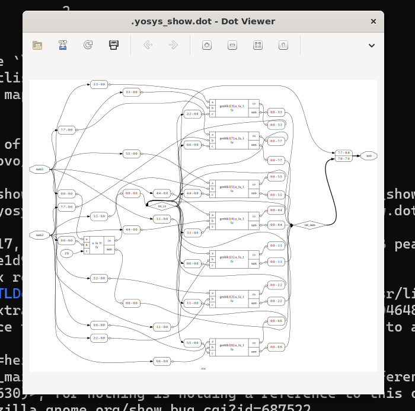

**Observation:**
- The schematic shows **eight `fa` instances**: `u_fa_0` (carry-in tied to `1'0`) plus the seven generated copies **`genblk1[1].u_fa_1` … `genblk1[7].u_fa_1`**. Yosys names each `generate` iteration `genblk1[i]`.
- Each stage's `co` feeds the next stage's `c` through `int_co`; the `int_sum` bits and `int_co[7]` are concatenated into the 9-bit `sum`.

---

## Key Learnings

- Every output of a combinational `always` block must be assigned on **every** path. Otherwise a latch (`$_DLATCH_P_` / `$_DLATCH_N_`) is inferred.
- Use a final `else`, a `default` in `case`, or a default assignment at the top of the block to prevent latches.
- Overlapping or wildcard `case` items (`2'b1?` in a plain `case`) simulate differently from the synthesized hardware.
- A procedural `for` loop evaluates logic (MUX/DEMUX); a `for-generate` loop **replicates** hardware (ripple-carry adder).
- Assign a default value before a procedural `for` loop to avoid a leftover latch (`mux_generate` vs. `demux_generate`).

[← Day 4](../Day_4/README.md) · [Back to RTL index](../README.md)
