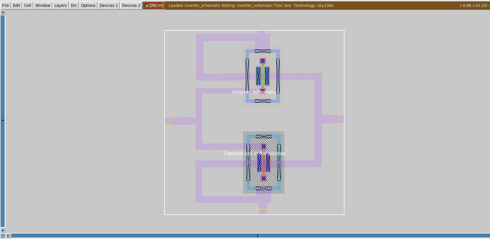

# Screening Assessment — CMOS Inverter Design, Simulation & Layout (SKY130A)

This directory contains verification screenshots and lab outputs completed during the screening assessment for the Women in Semiconductors: VLSI Design Engineer Program (570 Hours) conducted by VSD – SFAL – ESSCI – Marvell.

---

## Assessment Scope & Workflow

1. **Environment & PDK Setup:** Configured the open-source EDA workspace and SkyWater 130 nm PDK (`sky130A`) in Magic VLSI.
2. **Schematic Capture & SPICE Simulation:** Built a transistor-level CMOS inverter and testbench in Xschem, resolved subcircuit model inclusion issues, and verified transient switching waveforms using Ngspice.
3. **Parameterized Cell (PCell) & Custom Layout:** Generated `sky130A` NMOS devices, inspected device properties (`what`), and constructed the CMOS inverter physical layout in Magic VLSI.

## Tools & Technology Used
* **PDK:** SkyWater `sky130A` (130 nm open-source process design kit)
* **Schematic Capture:** Xschem
* **Circuit Simulator:** Ngspice
* **Physical Layout & Verification:** Magic VLSI

---

## 1. Environment & SkyWater `sky130A` PDK Setup

### Workspace Configuration
Organized the screening assessment directory structure with dedicated folders for schematics, simulation netlists, layouts, and PDK configuration files.

### Magic VLSI Startup with `sky130A` Technology
Launched Magic VLSI using the SkyWater `sky130A` technology file (`magic -T sky130A`) to initialize the 130 nm layout layers, design rules, and device generators.

---

## 2. CMOS Inverter Schematic Capture & SPICE Simulation (Xschem & Ngspice)

### CMOS Inverter Symbol & Transistor Schematic
Designed the complementary CMOS inverter schematic in Xschem using `sky130_fd_pr__pfet_01v8` (pull-up PMOS) and `sky130_fd_pr__nfet_01v8` (pull-down NMOS) devices with labeled `IN`, `OUT`, `VDD`, and `GND` ports.

### Testbench Schematic
Instantiated the CMOS inverter symbol inside a simulation testbench driven by a DC power supply (`VDD = 1.8 V`), a pulse input voltage source (`PULSE`), and Ngspice control commands for transient analysis.

### Debugging `unknown subckt` Model Inclusion Error
During initial netlist simulation, Ngspice flagged an `unknown subckt` error because the `sky130A` SPICE device library models (`sky130.lib.spice`) were not yet linked into the simulation netlist. Including the corner model library resolved the reference error.

### Ngspice Transient Simulation Log
Re-ran the updated netlist in Ngspice after linking the `sky130A` model library, confirming clean netlist parsing, DC operating point convergence, and transient simulation execution.

### Transient Switching Waveform Verification
Verified the transient response (`tran`), confirming proper logic inversion where `V(out)` transitions cleanly between `0 V` (logic `0`) and `1.8 V` (logic `1`) opposite the input pulse `V(in)`.

---

## 3. Parameterized Cell (PCell) & Physical Layout (Magic VLSI)

### Generating `sky130A` NMOS Parameterized Cell
Generated a parameterized `sky130A` NMOS transistor (`sky130_fd_pr__nfet_01v8`) in Magic VLSI with specified channel width (`W`), channel length (`L`), and source/drain diffusion contacts.

### Inspecting Device Properties (`what` Command)
Used the `what` command in the Magic command console to verify the active cell hierarchy, layer definitions, and extracted device parameters.

### CMOS Inverter Physical Layout
Completed the full CMOS inverter physical layout in Magic VLSI by placing the PMOS inside an N-well, aligning polysilicon gates for `IN`, routing `locali`/`met1` interconnects for `OUT`, and adding `VDD` (`vpwr`) and `GND` (`vgnd`) power rails with substrate/well taps.

